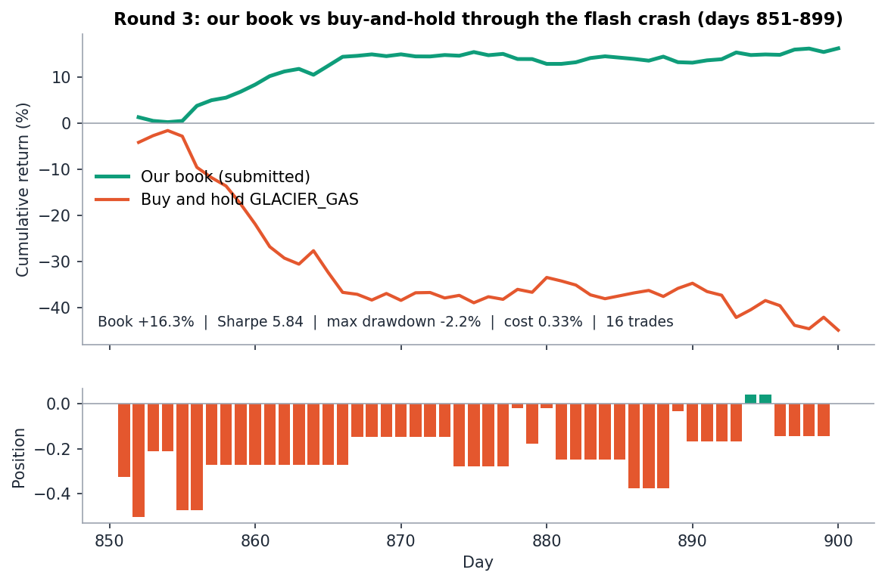
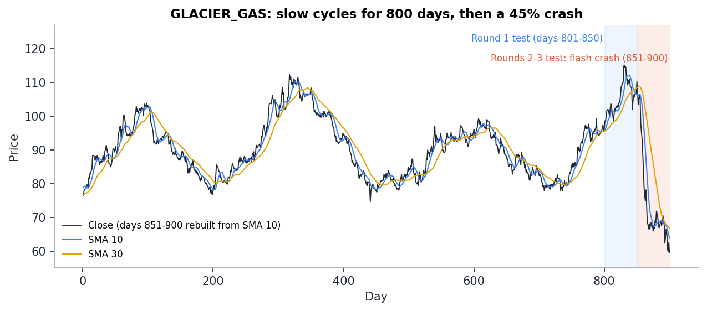
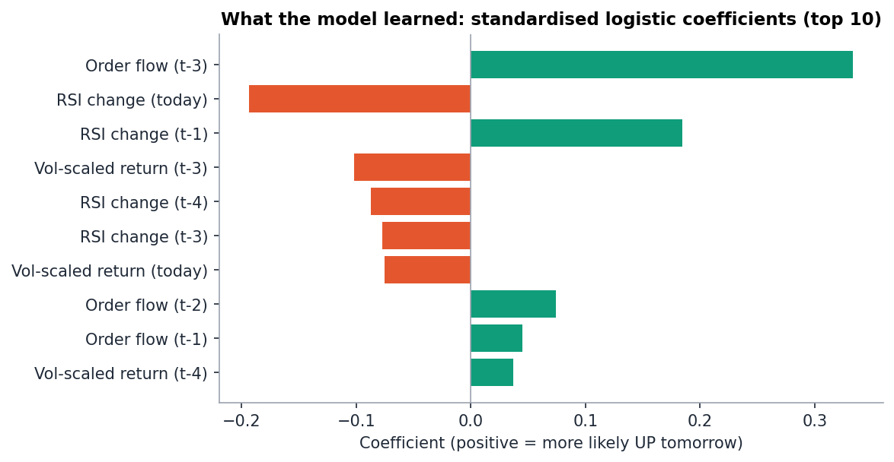
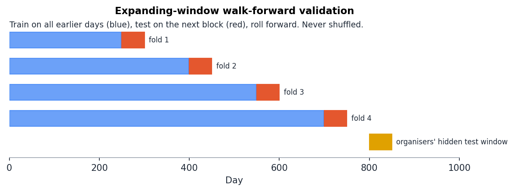
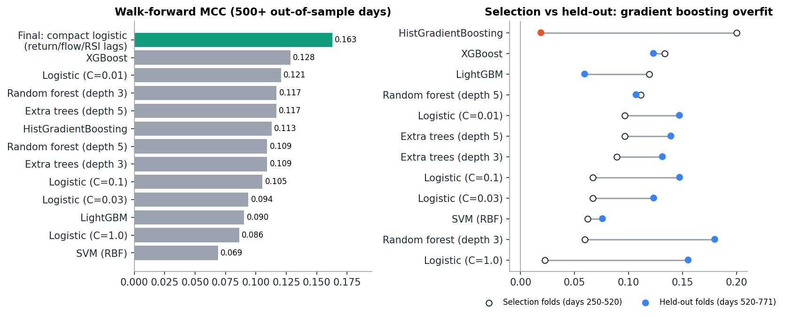
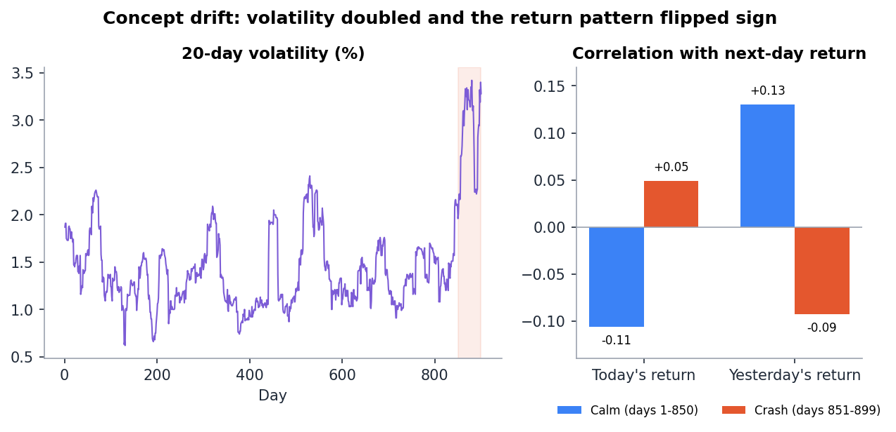
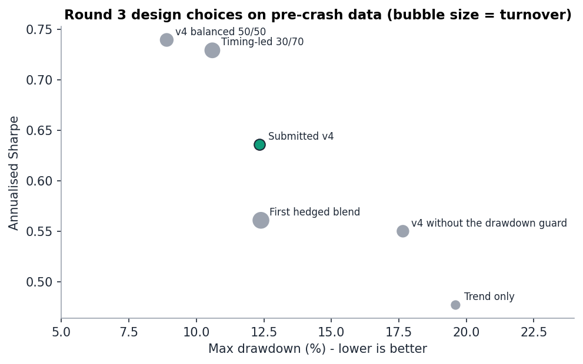

# Trading Through a Flash Crash: GLACIER_GAS Quant Challenge

[](https://github.com/ashiqhameed/glacier-gas-quant-challenge/actions/workflows/tests.yml)


**2nd prize (₹3,000) at the Abhiyantriki 2026 Quant Challenge** (Datazen, Somaiya Vidyavihar University, 15–16 October 2026).
Team *only head no job*: **Ashiq Hameed, Abhishek Jain, Shaunak Gulhane**.

Over three timed rounds we predicted the daily direction of a stock, then traded it through an organiser-injected flash crash. When the stock fell **44.9%**, our risk-managed book **made 16.3%** with an annualised **Sharpe ratio of 5.84**, a **maximum drawdown of 2.2%** and only 16 trades.



## Highlights

- **Audited the data before modelling.** By inverting Wilder's RSI we proved the organisers' hidden Round 1 test rows were computed differently from the training rows (order flow and volatility from the open price, noisy RSI), which explained why every model scored at chance there.
- **Rebuilt the hidden prices exactly.** In Rounds 2–3 we recovered every hidden close from the 10-day moving average using same-day information only, and verified it against five other indicators (worst error 0.005).
- **Chronological validation only.** Twelve models compared with expanding-window walk-forward tests over 500+ out-of-sample days; the held-out folds exposed gradient boosting as an overfit (MCC 0.20 when selecting, 0.02 afterwards).
- **Detected concept drift.** In the crash, volatility doubled and the stock's short-term return pattern flipped from reversal to momentum; inverting the calm-market model's timing turned a 3.38 score into 29.96.
- **Built a position engine for Sharpe, drawdown and cost.** Trend-led signal, volatility targeting, a drawdown guard and a no-trade band, with every setting fixed on pre-crash data. Public Round 3 score: **100/100**.
- **Fully reproducible.** One command reruns the whole pipeline and regenerates every file we uploaded during the event, byte for byte.

## The competition

Each team received its own stock and slice of history: for us, 900 trading days of GLACIER_GAS prices and indicators. Rounds were one hour each, with 10 uploads shared across all rounds.

| Round | Days | Task | Scored on |
| --- | --- | --- | --- |
| 1. Foundation | 801–850 | Predict UP/DOWN for each day in a calm market | Balanced accuracy and MCC (coin flip ≈ 16.7/100) |
| 2. Signal hunt | 851–900 | Same task after a mid-event **flash crash** | Same |
| 3. Alpha | 851–900 | Daily position from −1 (short) to +1 (long), backtested | Sharpe ratio, max drawdown (2× penalty), cost 0.001 per unit traded |
| Finale | – | Top 6 present and defend their strategy | Methodology, validation, crash adaptation and risk, code defence, delivery |



## Approach

### 1. Audit the data first

Each prediction for day *t* is about tomorrow (`target = close[t+1] > close[t]`), so anything known by the end of day *t* may be used and nothing after it.

| Round 1 hidden rows | Training rows | Hidden test rows |
| --- | --- | --- |
| `order_flow` | close location in the day's range | **open** location (matches to 0.00005) |
| `volatility_20` | from closes | from closes with the hidden ones **replaced by opens** |
| `rsi_14` | exact Wilder RSI | altered: closes rebuilt from it fall inside the day's range only **14%** of the time (100% on known rows) |

In Round 2 the hidden rows were genuine. A 10-day average moves by a tenth of the newest close minus the one leaving the window, so

```
close[t] = 10 × (sma_10[t] − sma_10[t−1]) + close[t−10]
```

recovers each hidden close from information available that day. Recomputing RSI, volatility, order flow, momentum and the 30-day average from these closes matched the organisers' columns to within 0.005.

### 2. Features

All features for day *t* use day *t* or earlier, and returns are divided by 20-day volatility so a move means the same thing in calm and crash markets.

| Group | Definition |
| --- | --- |
| Volatility-scaled returns, lags 0–4 | `r[t-k] / σ20[t-k]` |
| Order flow, lags 0–4 | `(2·close − high − low) / (high − low)` |
| RSI momentum, lags 0–4 | `ΔRSI14` |
| Stress | 20-day drawdown divided by volatility |
| Trend (Round 3) | `(SMA10 / SMA30 − 1) / σ20`, halved when 5-day momentum disagrees |

In calm markets GLACIER_GAS returns alternate: correlation of tomorrow's return with today's is −0.11 and with yesterday's +0.13, which is what the lagged features capture.



### 3. Model selection and validation



Every model was scored by expanding-window walk-forward validation with a one-day purge, never shuffled K-fold. Folds on days 250–520 were used to choose; later folds were held back to confirm.



The shipped model is a **regularised logistic regression ensemble** (balanced class weights, L2, averaged over 4–6 lags × C ∈ {0.05, 0.1}, recency-weighted with a 150-day half-life):

| Check | Result |
| --- | --- |
| Walk-forward, 542 out-of-sample days | MCC **0.163**, balanced accuracy 0.581 |
| Bootstrap 95% CI for MCC | [0.080, 0.251] |
| 50-day blocks (size of the real test) | positive in 10 of 10 |
| Neighbouring settings (3–7 lags × 4 values of C) | MCC 0.10–0.17 |
| Untouched days 801–850 (revealed after Round 1) | MCC **0.152** (return-pattern model); **0.206** with the Round 2 recipe |

### 4. The crash: detecting concept drift



Three causal signals flagged the new regime: 20-day volatility above 1.3× its 250-day median (it doubled to 3.3%), the 10-day average crossing below the 30-day, and a sign flip in the return autocorrelation. Our calm-market model, run unchanged through the crash, scored **3.38** (below the coin-flip line). Its exact inverse scored **29.96**, and because the scoring is symmetric around 16.67 (3.38 + 29.96 = 2 × 16.67), this confirmed the model's signal had inverted rather than vanished. The decision to invert was prompted by that leaderboard score; the autocorrelation table above, computed once the round had closed, shows the market really did switch from reversal to momentum.

### 5. Round 3: the position engine

```
signal   = clip(0.7 × trend + 0.3 × timing, −1, 1)       # timing = inverted Round 2 model edge
size     = min(1, 1.2% / σ20)                             # volatility targeting
guard    = halve size while the book is > 6% below its peak (P&L up to day t only)
position = keep yesterday's position unless the target moves by > 0.12   # no-trade band
```

All settings were chosen on days 300–849, before the crash:

| Variant (days 300–849, with costs) | Sharpe | Max drawdown | Turnover / day |
| --- | --- | --- | --- |
| Trend only | 0.48 | −19.6% | 0.07 |
| First hedged blend (no guard, no band) | 0.56 | −12.4% | 0.49 |
| **Submitted v4** | **0.64** | **−12.3%** | **0.13** |
| v4 without the drawdown guard | 0.55 | −17.6% | 0.22 |
| v4 balanced 50/50 | 0.74 | −8.9% | 0.29 |



The drawdown guard alone lifted Sharpe from 0.55 to 0.64, cut the worst drawdown by a third and turnover by 40%. We chose the trend-led weighting over the calmer-market favourite (50/50) because a crash is a strong trend.

## Results

| Round | What we submitted | Public score | Final (private) score |
| --- | --- | --- | --- |
| 1 | Logistic ensemble on open/high/low/volume features (the only columns consistent in the altered hidden rows) | 17.22 | 12.89 |
| 2 | Regime-inverted logistic ensemble | 29.96 | 6.30* |
| 3 | Position engine v4 | **100** | 73.08 |

\*A late upload of a separately trained model replaced our best Round 2 file; the platform keeps the latest upload, not the best (see Lessons).

On the cumulative leaderboard (weights 20% / 35% / 45%) we were 6th of 13, which qualified us for the finale, where judges scored methodology, validation rigour, crash adaptation, risk management and code defence. We finished **2nd overall**. Every number above can be regenerated with `scripts/run_all.py`; [`results/`](results/) holds the outputs and [`docs/methodology.md`](docs/methodology.md) the full write-up.

## Lessons learned

1. **Audit before you model.** The biggest Round 1 risk was not the model but inputs that changed meaning at test time.
2. **Validate chronologically and keep a holdout.** The best-looking model during selection (gradient boosting) was the worst afterwards.
3. **Treat regime shifts as first-class.** A calm-market edge can invert, not just fade, in a crash.
4. **Size for the metric.** Sharpe is unchanged by scaling positions, but drawdown and costs are not; volatility targeting, a drawdown guard and a no-trade band moved all three in the right direction.
5. **Submission discipline matters.** When the latest upload counts, validate every candidate offline and always finish on the best file.

## Repository structure

```
├── src/glacier/            # the package
│   ├── data.py             # loading, RSI and SMA-10 price reconstruction, indicator recomputation
│   ├── features.py         # return-pattern, open-only, broad and trend features
│   ├── models.py           # logistic ensemble, recency weights, 12-model zoo
│   ├── validation.py       # walk-forward folds, scores, block MCC, bootstrap CI
│   ├── backtest.py         # position engine and Sharpe / drawdown / cost metrics
│   └── submission.py       # upload formats and checks against the submitted files
├── scripts/                # numbered pipeline, run in order by run_all.py
│   ├── 01_audit_round1.py ... 09_make_figures.py
├── tests/                  # unit tests on synthetic data (no competition data needed)
├── submissions/            # the files we actually uploaded, with their scores
├── results/                # metrics written by the scripts
├── figures/                # charts used in this README
├── docs/                   # methodology write-up and the finale presentation (PDF + PPTX)
└── archive/event_scripts/  # the original scripts written during the 4-hour event
```

## Reproducing

```bash
git clone https://github.com/ashiqhameed/glacier-gas-quant-challenge.git
cd glacier-gas-quant-challenge
pip install -e ".[dev]"
pytest                       # 12 unit tests, no data needed
```

The competition data belongs to the organisers and is not included. Put the round files in `data/` (see [`data/README.md`](data/README.md)), then:

```bash
python scripts/run_all.py    # about 2 minutes
```

Each submission script prints whether its regenerated file is identical to the one uploaded during the event.

## Team

**only head no job**: Ashiq Hameed, Abhishek Jain and Shaunak Gulhane.

Thanks to Datazen and Somaiya Vidyavihar University for organising the Abhiyantriki 2026 Quant Challenge.

## License

[MIT](LICENSE)
